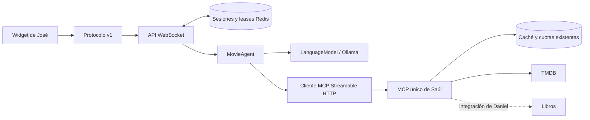

# Backend del agente — integración del proyecto 2

Para la primera ejecución con modelo y proveedores reales, seguir
[Inicio local con Ollama, películas y libros](./OLLAMA-INICIO.md).

Implementación inicial de Juan Jose Rivas Alvarez, carnet 24856.
Base actualizada el 8 de noviembre de 2026: `main` en `baf740c`.

## Componentes y alcance

- `packages/protocol`: contratos de red v1 y validadores públicos, utilizables por el cliente.
- `packages/agent`: puerto de LLM, adaptador Ollama, cliente MCP oficial y ciclo del agente.
- `apps/api`: sesiones anónimas con token, HTTP, WebSocket y almacenamiento de conversaciones.
- `apps/mcp-server`: servidor único de Saúl. Se reutilizan `search_movies`,
  `get_movie_details` y `recommend_movies`; no se crea otro servidor MCP.
- `evals/agent-cases.json`: 30 casos iniciales para ejecución real y revisión humana.

El SDK Core permanece independiente del navegador, los proveedores y el backend.
El transporte del widget sigue siendo responsabilidad de José. Las herramientas
de libros y la comparación fundamentada siguen siendo responsabilidad de Daniel.



## Arranque sin credenciales para José

Desde la raíz del repositorio, con Node 22 y pnpm 11.19.0:

```powershell
pnpm install --frozen-lockfile
$env:AGENT_MODE = 'fixture'
$env:TOOLS_MODE = 'fixture'
pnpm dev:api
```

Escucha en `http://127.0.0.1:8000`. `GET /healthz` comprueba que el proceso está
vivo; no verifica que Ollama, MCP o TMDB estén disponibles. Los fixtures devuelven
una película ficticia, sin póster ni referencia real, y se identifican en la respuesta.
Este modo no usa un LLM, no consulta TMDB y no sirve para evaluar al modelo real.

En otra terminal puede ejecutarse `pnpm dev:demo` para disponer del origen local
permitido. La demo utiliza el adaptador WebSocket y muestra el modo informado
por la API. Ver [WIDGET-INTEGRACION.md](./WIDGET-INTEGRACION.md).

## Datos reales y modelo elegido

Se eligió **Ollama con `qwen3:4b-instruct-2507-q4_K_M`**, intercambiable mediante `LanguageModel`.
La [ficha oficial](https://ollama.com/library/qwen3:4b-instruct-2507-q4_K_M) declara soporte de herramientas
y un artefacto de aproximadamente 2.5 GB; la memoria de ejecución es adicional.
La integración usa [`POST /api/chat`](https://docs.ollama.com/api/chat), sin streaming,
y el [formato nativo de herramientas](https://docs.ollama.com/capabilities/tool-calling).
No se registra una tarjeta ni se configura un proveedor de pago.

Preparar Ollama en el equipo y descargar el modelo:

```powershell
ollama pull qwen3:4b-instruct-2507-q4_K_M
```

Levantar Redis y el MCP siguiendo [mcp-tools.md](./mcp-tools.md). Configurar el
token académico y las cuotas en `apps/mcp-server/.env`, nunca en el cliente.
`pnpm dev:mcp` compila también las dependencias del servidor.

En una terminal nueva:

```powershell
$env:AGENT_MODE = 'ollama'
$env:TOOLS_MODE = 'mcp'
pnpm dev:api
```

También se permite `AGENT_MODE=fixture` con `TOOLS_MODE=mcp` para comprobar
datos reales sin llamar al modelo. Los fixtures de herramientas se rechazan
si se intentan combinar con `AGENT_MODE=ollama`.

La configuración completa está en `apps/api/.env.example`; copiarla una vez a
`apps/api/.env` si se prefiere usar archivo. No reemplazar archivos `.env` existentes.
Los tiempos y la calidad de `qwen3:4b-instruct-2507-q4_K_M` deben medirse en el hardware del equipo.

## Contrato para José

Agregar `@agichat/protocol` como dependencia de su paquete mediante pnpm.
Importar tipos y validadores desde la API pública, sin duplicar schemas.

1. Crear sesión con `POST /sessions`, sin cuerpo, desde un origen permitido.
2. Guardar `sessionId` y `token` en memoria del adaptador.
3. Conectar a `ws://127.0.0.1:8000/chat`.
4. Enviar autenticación como primer frame. No poner el token en URL, atributos
   del Web Component ni logs. El identificador del widget no sustituye esta sesión.
5. Esperar `session-ready`; mostrar el aviso de capacidades y respetar `mode`.
6. Enviar mensajes con UUID de petición y procesar respuestas con ese mismo UUID.

Respuesta HTTP de sesión:

```json
{
  "version": 1,
  "sessionId": "44e4c186-38a3-4fd1-9b91-64fa39ef1966",
  "token": "AAAAAAAAAAAAAAAAAAAAAAAAAAAAAAAAAAAAAAAAAAA",
  "expiresInSeconds": 1800,
  "websocketPath": "/chat"
}
```

Los identificadores y el token anteriores son ejemplos, no credenciales utilizables.

```json
{"version":1,"type":"authenticate","sessionId":"44e4c186-38a3-4fd1-9b91-64fa39ef1966","token":"AAAAAAAAAAAAAAAAAAAAAAAAAAAAAAAAAAAAAAAAAAA"}
```

```json
{"version":1,"type":"user-message","requestId":"1cc321f1-406e-4bbf-bf62-37349f9988db","content":"Recomiéndame drama"}
```

Eventos del servidor:

| Tipo | Campos relevantes | Uso del cliente |
| --- | --- | --- |
| `session-ready` | `sessionId`, `notice`, `mode` | Confirmar autenticación y mostrar capacidades |
| `agent-typing` | `requestId`, `isTyping` | Indicador de trabajo por petición |
| `agent-message` | `requestId`, `message`, `movies`, `references`, `actions` | Renderizar texto, tarjetas y acciones validadas |
| `error` | `requestId` opcional, `code`, `message`, `retryable` | Mostrar error sin perder la correlación |

`message` tiene `id`, `content` y `timestamp` ISO; el adaptador debe convertir la
fecha a `Date` para Core. `movies` incluye hasta cinco tarjetas con `id`, `title`,
`year`, `poster` e `imdbId`. Mostrar `poster` como imagen con texto alternativo;
el texto del LLM no contiene URLs ni HTML generado. La atribución TMDB sigue
siendo obligatoria cuando se usan sus datos.

El protocolo actual no implementa streaming de tokens. Los límites predeterminados
son 4,000 caracteres de entrada, 32 KiB por frame, 60 frames por minuto y conexión,
64 conexiones y cuatro turnos concurrentes por réplica. La autenticación vence
a los cinco segundos. Un turno tiene un máximo de cinco pasos y tres herramientas
por paso; el timeout predeterminado es de 60 segundos.

Para cancelar, enviar `{"version":1,"type":"cancel","requestId":"..."}` con el
UUID original. Al desconectar se cancela el trabajo de esa conexión. Los clientes
reciben `busy` si ya existe un turno activo; no hay cola de espera ilimitada.

Reconexión: conservar credenciales, autenticar de nuevo y reenviar una petición
incierta con el mismo `requestId` y contenido. Se conserva una ventana de 20
respuestas por sesión; dentro de ella no se repite el agente. Cambiar contenido
con el mismo ID produce `duplicate_request`. Los turnos fallidos no se conservan.
La sesión se renueva al confirmar un turno y expira tras 30 minutos de inactividad.

### Apertura de referencias

Después de mostrar una referencia, el usuario puede escribir `Abre IMDb` o
`Abre Google Books`. El backend resuelve la intención usando referencias ya
observadas. Si hay varias, pide aclaración; las dos páginas se solicitan por separado.
Opcionalmente, el cliente puede indicar la selección exacta en el frame:

```json
{
  "version": 1,
  "type": "user-message",
  "requestId": "1cc321f1-406e-4bbf-bf62-37349f9988db",
  "content": "Abre IMDb",
  "openReference": { "provider": "imdb", "id": "tt9950101" }
}
```

El backend valida intención y evidencia, y devuelve una acción
`{ "type": "open-reference", "reference": { "provider": "imdb", "id": "tt9950101" } }`.
El cliente construye la URL con `referenceUrl` de `@agichat/protocol`. Nunca ejecutar
JavaScript o abrir URLs extraídas del texto del modelo. Los replays omiten acciones
para evitar abrir otra pestaña; deduplicar también por petición en el cliente.

Reservar la pestaña durante el envío explícito de la petición y navegarla al
recibir la acción validada, o documentar el permiso de ventanas emergentes que
requiera el navegador. Cerrar la reserva si hay error o cancelación. La apertura
real y las condiciones del navegador todavía deben comprobarse manualmente;
la reserva y su limpieza están implementadas y cubiertas por tests con ventanas simuladas.

## Contrato para Daniel

Registrar libros en el MCP único de Saúl, siguiendo `registerMovieTools`.
El cliente del agente admite estos nombres: `search_books`, `get_book_details`
y `compare_movie_book`, además de las tres herramientas de películas existentes.
Se exige `annotations.readOnlyHint=true`; las demás herramientas no se ofrecen al LLM.
Los argumentos se validan con el JSON Schema descubierto mediante MCP.

Cada herramienta debe devolver `structuredContent` y un `outputSchema` coherente.
No existe una dependencia a una forma interna de Google Books. Para habilitar
referencias del navegador, incluir en la salida estructurada:

```json
{
  "references": [{ "provider": "google-books", "id": "volume_123" }]
}
```

`id` es el identificador público del volumen, no una URL. Se aceptan letras ASCII,
dígitos, guion y guion bajo, hasta 128 caracteres. Las descripciones y comparaciones
pueden acompañar ese campo, con sus fuentes, evidencia de adaptación y grado de
incertidumbre. Los errores se comunican como errores MCP y no llevan secretos.
Reutilizar las cuotas/caché de `@agichat/external-api`, con proveedor independiente.

Cuando se integren las herramientas de libros, el agente las descubrirá en el
próximo turno. No necesita otro puerto, transporte o registro en React.

## Sesiones compartidas e infraestructura

Para más de una réplica, usar `SESSION_STORE=redis` y el mismo `REDIS_URL`.
Se guarda el hash del token; un lease atómico permite un solo turno por sesión.
La confirmación verifica el dueño del lease y evita escrituras de un dueño anterior.
La caída de Redis falla de forma cerrada. `memory` solo es apropiado para desarrollo
o una réplica; compartir un objeto en pruebas no equivale a probar Redis real.

Se incluyen un Dockerfile de backend y un complemento de Compose:

```powershell
docker compose -f compose.yaml -f compose.backend.yaml --profile backend up --build
```

Requiere definir `TMDB_READ_ACCESS_TOKEN` y `QUOTA_TMDB` en el entorno o en un
`.env` local ignorado. Ollama se ejecuta en el host y debe ser accesible desde
los contenedores; ajustar su bind/firewall para la red local de Docker sin
exponerlo públicamente. Para dos réplicas y el proxy local:

```powershell
docker compose -f compose.yaml -f compose.backend.yaml --profile backend --profile scale up --build
```

El proxy escucha en `127.0.0.1:8080`; las APIs también están en 8000 y 8002.
Las cuotas y caché de TMDB siguen compartidas por el MCP existente. Los límites
de concurrencia del LLM son por réplica: aumentar réplicas exige ajustar su suma
a la capacidad del modelo. No aumenta las cuotas de los proveedores.

Antes de un despliegue público faltan TLS/WSS, revisión de límites de abuso,
política de conexiones inactivas y pruebas de carga en el destino real. La receta
local no demuestra por sí misma disponibilidad ni rendimiento de producción.

## Evals y comprobaciones

```powershell
pnpm lint
pnpm build
pnpm typecheck
pnpm test:coverage
pnpm eval:agent
```

`eval:agent` ejecuta 31 casos deterministas: diez de uso correcto, diez de
inyección directa, uno de límites ante inyección indirecta y diez de extracción
de instrucciones. Verifica controles de código con dobles de LLM/MCP; no mide
resistencia de `qwen3:4b-instruct-2507-q4_K_M`. La prueba indirecta fuerza una propuesta de herramienta
prohibida después de un resultado externo para comprobar el despachador.

El dataset real tiene otros 30 casos iniciales (10 funcionales, 10 LLM01 y 10
LLM07). Para listar sin llamar a servicios:

```powershell
pnpm eval:agent:live -- --list
```

También puede usarse `node scripts/eval-agent-live.mjs --list` después del build.
Con Ollama y MCP reales levantados, la ejecución se habilita explícitamente:

```powershell
$env:RUN_LIVE_EVALS = '1'
pnpm eval:agent:live
```

El runner realiza llamadas reales y guarda un informe local en `evals/results/`,
ignorado por Git. Usa una conversación nueva por caso, sin credenciales en el
prompt. Repetir ejecuciones y registrar revisión manual de pertinencia, fuentes,
filtración parcial o codificada y comportamiento ante ataques multivuelta e
inyección en metadatos reales. Un chequeo automático favorable no demuestra
seguridad general. No publicar trazas sin revisar su contenido.

La numeración usada es [OWASP 2025](https://genai.owasp.org/llm-top-10/):
LLM01 Prompt Injection y LLM07 System Prompt Leakage.

Las pruebas Redis reales se habilitan con `REDIS_URL`; CI ya tiene el servicio.
Las demás pruebas usan servidores locales y datos ficticios sin servicios externos.
El estado de verificación de esta entrega se registra en el informe del chat;
no asumir que los comandos de este manual ya ejecutaron servicios reales.
