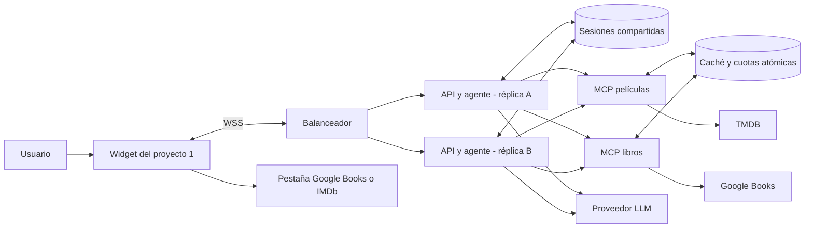
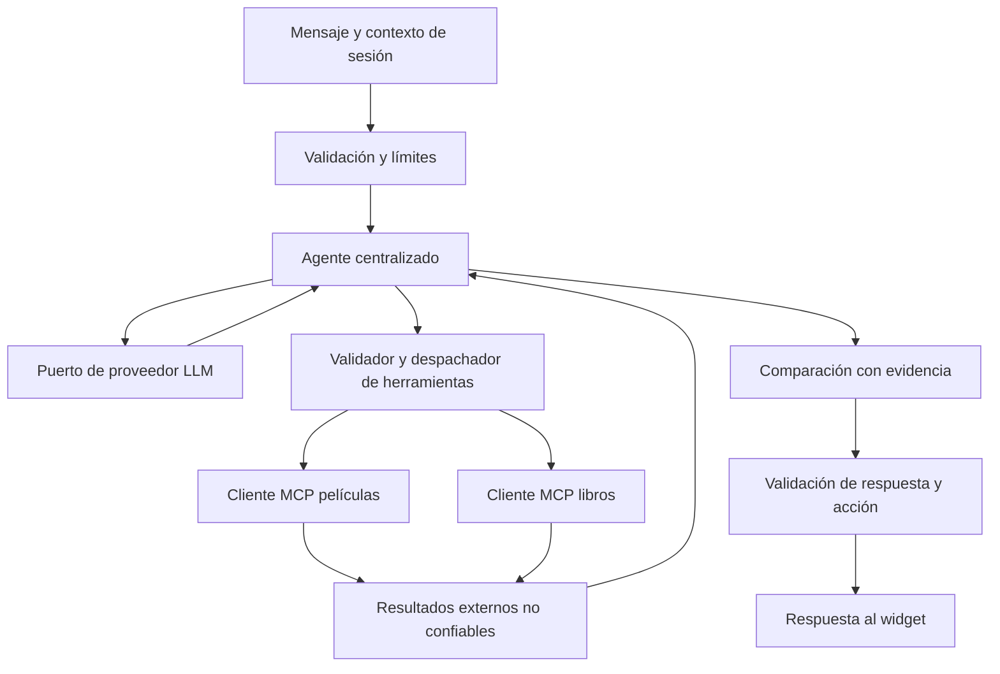

# Proyecto 2 — reparto de trabajo y plan de integración

Curso: CC3116, Universidad del Valle de Guatemala. Fecha: 27 de octubre de 2026.

Equipo: Juan Jose Rivas Alvarez (carnet 24856), Saúl, Daniel, José e Isma.
Guallim ya no forma parte del grupo y no tiene tareas asignadas en esta fase.

Este documento planifica el trabajo; no declara implementados los requisitos.
No se fijan fechas de entrega porque no se ha proporcionado el calendario del curso.

Es el plan inicial del 27 de octubre, conservado como referencia del reparto y
las dependencias. Las rutas propuestas y los hitos describen ese momento; no son
una lista actual de pendientes ni los diagramas finales de entrega. Para el
arranque y los contratos implementados, consultar [BACKEND-AGENTE.md](./BACKEND-AGENTE.md),
[OLLAMA-INICIO.md](./OLLAMA-INICIO.md) y [WIDGET-INTEGRACION.md](./WIDGET-INTEGRACION.md).

## Punto de partida comprobado el 27 de octubre de 2026

- Base: `main`, commit `cd7a01d`, sincronizado con `origin/main` mediante
  `git pull --ff-only origin main`.
- El proyecto 1 entrega Core, widget React, Web Component, transporte mock,
  demo y CI con cobertura mínima del 80% por paquete.
- `packages/transport-websocket` todavía rechaza los envíos con
  `WebSocketTransportNotImplementedError`; falta la conexión real.
- Los mensajes del transporte contienen texto, identificador y fecha. Falta
  acordar el protocolo de red y las acciones estructuradas de navegación.
- React ya utiliza Markdown sin HTML crudo. Hay que validar específicamente
  imágenes, dominios y acciones; no asumir que el renderizado actual resuelve
  todos los requisitos del producto.

## Reparto entre los cinco participantes

| Responsable | Trabajo principal | Entregable verificable | Rama inicial sugerida |
| --- | --- | --- | --- |
| **Juan Jose Rivas Alvarez** | Backend, agente, infraestructura y controles de seguridad | Conversación real desde el servidor, agente que usa MCP, sesiones aisladas, despliegue reproducible y runner de evals | `feature/agent-backend` |
| **Saúl** | Películas y servidor MCP de TMDB | Herramientas de búsqueda, detalle, recomendación, póster e identificador IMDb; caché y cuota compartida | `feature/mcp-movies` |
| **Daniel** | Libros, servidor MCP de Google Books y comparación | Búsqueda y detalle de libros, asociación verificable película–libro y comparación fundamentada | `feature/mcp-books-comparison` |
| **José** | Widget, WebSocket e integración del producto | Chat conectado, póster visible, atribución TMDB y apertura de referencias sin pulsar enlaces | `feature/widget-movie-integration` |
| **Isma** | Documentación y preparación de entrega | Diagramas, justificación de escalabilidad, manuales, matriz de requisitos y evidencias de evals | `docs/proyecto-2` |

Los cuatro responsables técnicos implementan código y pruebas de su área.
Isma concentra la documentación, con datos y evidencias aportados por cada autor.

### Juan Jose — backend, agente y operación

Rutas propuestas: `apps/api`, `packages/agent`, `packages/protocol`, `infra/`
y `evals/`. Son rutas nuevas salvo que se indique lo contrario.

1. Acordar con José el protocolo compartido antes de conectar cliente y servidor:
   versión, `sessionId`, `requestId`, mensajes, escritura, errores y acciones.
   Publicar los tipos y validadores desde `packages/protocol/src/index.ts`.
2. Implementar el servidor WebSocket y el caso de uso conversacional con un
   puerto de proveedor LLM inyectable. Elegir y registrar modelo, proveedor,
   límites y acceso sin tarjeta antes de depender de un servicio concreto.
3. Implementar un agente que seleccione y consuma herramientas MCP de películas
   y libros, conserve contexto por sesión y produzca respuestas con fuentes.
   Al inicio debe ofrecer explícitamente comparar películas con sus libros.
4. Aplicar validación determinista de herramientas, argumentos y acciones;
   aislar sesiones; limitar tamaño de mensajes, pasos del agente, concurrencia,
   duración y reintentos. Las descripciones externas son datos no confiables.
5. Mantener credenciales fuera de prompts, respuestas, logs y cliente. Aplicar
   defensas contra extracción de instrucciones internas y salidas sensibles.
   Los controles de autorización viven en código, no solamente en el prompt.
6. Preparar contenedores, configuración de ejemplo sin secretos, TLS/WSS en el
   despliegue, orígenes permitidos, health checks y cierre de conexiones.
   El servidor deriva o valida la sesión; no confía en un `sessionId` arbitrario.
7. Usar almacenamiento compartido para sesiones y coordinar con Saúl la caché
   y los contadores de cuota. Demostrar dos réplicas con aislamiento de sesiones,
   reconexión, límites globales y medición de latencia/errores.
8. Integrar en CI el runner de evals y reunir los casos que aporten Saúl, Daniel
   y José. Mantener el orden de validación existente.

Aceptación: una conversación atraviesa el widget, servidor, agente y MCP real;
hay manejo de caída de LLM/MCP, cancelación y limpieza; las pruebas unitarias y
de integración usan dobles locales sin red. La evidencia con el modelo real
se registra aparte, sin presentar mocks como prueba de resistencia del LLM.

### Saúl — películas y MCP de TMDB

Rutas propuestas: `packages/movie-tools`, `apps/mcp-movies` y la implementación
de caché/cuota acordada con Juan Jose. La política común se reutiliza en libros.

1. Crear el cliente TMDB inyectable y normalizar búsqueda por título, filtros
   de preferencias, detalles y recomendaciones, con identificadores estables.
2. Exponer herramientas MCP con schemas de entrada y salida, por ejemplo
   `movies.search`, `movies.details` y `movies.recommend`.
3. Devolver título, año, sinopsis, géneros, valoración con su fuente, URL de
   referencia, póster válido y `imdbId` cuando exista. Manejar campos ausentes.
   Construir URLs a partir de identificadores y configuración del proveedor.
4. Implementar caché con TTL, deduplicación de solicitudes y reserva atómica
   de cuota diaria compartida entre réplicas. Contar cada llamada externa,
   incluidos reintentos, y separar el presupuesto de cada proveedor.
5. Tratar 1,000 solicitudes diarias por proveedor como tope del proyecto,
   configurable a un valor menor si la cuenta lo exige. No presentarlo como
   garantía vigente del proveedor. Manejar 429, timeout y cuota agotada.
6. Configurar la clave TMDB con uso no comercial e indicar que son estudiantes
   de CC3116 de la Universidad del Valle de Guatemala. Entregar a José los
   recursos oficiales de atribución; nunca guardar la clave en Git.
7. Entregar fixtures de éxito, ambigüedad, película sin póster/IMDb, fallo de API
   y sinopsis maliciosa para pruebas y evals de inyección indirecta.

Aceptación: un cliente MCP distinto del agente descubre e invoca las herramientas;
las pruebas no requieren TMDB; dos réplicas no duplican el presupuesto disponible.

### Daniel — libros y comparación

Rutas propuestas: `packages/book-tools`, `apps/mcp-books` y
`packages/agent/src/comparison/`. Juan Jose es dueño del resto de `packages/agent`.

1. Crear el cliente Google Books e implementar herramientas como `books.search`
   y `books.details`, con título, autores, fecha, descripción, identificador,
   fuente y URL de Google Books. Usar únicamente acceso a datos públicos.
2. Reutilizar caché, cuotas, timeout y política de reintentos de Saúl; mantener
   el contador de Google Books separado del de TMDB.
3. Implementar el caso de uso de asociación y comparación: cruzar título,
   autor y evidencia disponible de adaptación. No basta un título parecido
   para afirmar que una película adapta ese libro.
4. Producir una comparación basada en los datos recuperados: relación entre
   obras, diferencias respaldadas, preferencias del usuario y veredicto
   razonado sobre verla. No inventar escenas ni afirmar haber leído el libro
   completo a partir de una sinopsis; expresar incertidumbre cuando corresponda.
5. Cubrir película sin libro conocido, coincidencias ambiguas, libro sin
   descripción, búsqueda vacía y caída del proveedor. Ofrecer recomendaciones
   de películas aunque no se pueda completar una comparación.
6. Entregar a Juan Jose ejemplos de comparación correcta, falta de evidencia
   e inyecciones en descripciones de libros para el conjunto de evals.
7. Preparar acceso gratuito sin registrar tarjetas de crédito, como exige la
   consigna. Documentar la configuración y las cuotas efectivas de la cuenta.

Aceptación: el agente usa las herramientas MCP y distingue una adaptación
verificada de una coincidencia; la comparación incluye fuentes y limitaciones.

### José — widget, transporte y experiencia completa

Rutas existentes: `packages/transport-websocket`, `packages/react`,
`packages/embed` y `apps/demo`. Consumir las APIs públicas de los paquetes.

1. Sustituir el transporte reservado por WebSocket funcional: conexión, envío,
   recepción, validación de frames, reconexión acotada, errores y `dispose`.
   Coordinar tipos del protocolo con Juan Jose; no duplicarlos en el cliente.
2. Integrar la demo del producto de películas con el backend real mediante
   `ITransportAdapter`, conservando las integraciones React y Web Component.
3. Mostrar póster con texto alternativo, dimensiones adaptables y estado sin
   imagen. Validar URLs contra los orígenes de imágenes acordados y conservar
   Markdown seguro, navegación por teclado y mensajes de error accesibles.
4. Mostrar el logo oficial TMDB y el aviso de atribución en Créditos/Acerca de,
   según la [guía oficial](https://developer.themoviedb.org/docs/faq).
   El aviso requerido es: “This product uses the TMDB API but is not endorsed
   or certified by TMDB.”
5. Ejecutar una acción estructurada `open-reference` para Google Books e IMDb
   cuando el usuario lo pida en el chat, sin que deba pulsar un enlace.
   Usar destino e identificador validados, lista de hosts/rutas permitidos,
   HTTPS y aislamiento de `opener`. Nunca ejecutar JavaScript del agente.
6. Probar la apertura desde el primer hito: los navegadores pueden bloquear
   `window.open` tras una respuesta asíncrona. Evaluar reservar una pestaña
   durante el envío explícito de una petición de apertura y navegarla al
   recibir la acción validada; cerrar reservas fallidas y evitar duplicados.
   Si el navegador exige permitir ventanas emergentes para el sitio, indicarlo
   y documentar esa condición. Un enlace de respaldo no cuenta por sí solo
   como cumplimiento de la apertura solicitada. Véase [MDN](https://developer.mozilla.org/en-US/docs/Web/API/Window/open).
7. Probar frames inválidos, múltiples instancias, desmontaje, reconexión,
   póster fallido, acción duplicada/ajena a la petición y destinos maliciosos.
   Añadir una prueba de integración de navegador del recorrido completo.

Aceptación: desde el widget se recibe una recomendación real con póster, se
solicita comparación y se abren ambas referencias en peticiones separadas sin
pulsar enlaces. Registrar navegador y configuración usados en la demostración.

### Isma — documentación y entrega

Rutas: `docs/` y actualización final de `README.md`, coordinada con José.

1. Preparar diagramas de alto y bajo nivel y mantenerlos alineados con el
   código integrado; distinguir la arquitectura implementada de mejoras futuras.
2. Documentar por qué escala: réplicas, sesiones compartidas, caché/cuotas
   globales, límites de concurrencia, cuellos de botella de LLM/APIs y resultados
   de la prueba con dos réplicas. No afirmar que escalar cómputo aumenta cuotas.
3. Documentar instalación, variables sin secretos, arranque, despliegue,
   contratos MCP y ejemplos reproducibles de consumo por otro agente/cliente.
4. Crear matriz requisito → responsable → prueba → evidencia. Incluir versión
   OWASP, dataset, modelo/configuración y resultados de las evals suministrados
   por los autores; no fabricar resultados ni confundir cobertura con evals.
5. Preparar guion de demo, capturas, limitaciones, atribuciones, instrucciones
   sin tarjeta, GitHub Flow y enlace al repositorio funcionando.

Aceptación: otro integrante puede levantar el producto siguiendo los manuales;
los diagramas y resultados describen lo que efectivamente está desplegado.

## Arquitectura propuesta para acordar antes de implementar

Se propone **un agente centralizado con herramientas MCP**, suficiente para
este alcance. Dos servidores MCP no equivalen a dos agentes. No se necesita
inventar un MAS; si el equipo añade agentes autónomos, Isma actualizará el
diagrama, la clasificación y la justificación con la implementación real.

### Alto nivel



Cada conexión WebSocket pertenece a una réplica mientras está abierta; las
reconexiones deben recuperar la sesión desde el almacenamiento compartido.
Serializar turnos de una misma sesión o aplicar control de concurrencia para
evitar respuestas mezcladas. Validar la política WSS del balanceador.

### Bajo nivel del agente



Core conserva el dominio genérico del chat y no depende de navegador, React,
LLM o TMDB. El agente y la comparación pertenecen al backend; abrir pestañas
pertenece al cliente. Cada servidor MCP expone schemas y operaciones reales,
no solamente funciones internas con el nombre MCP.

## Evals y seguridad: responsabilidad compartida

Usar explícitamente **OWASP Top 10 para LLM 2025**: LLM01 es Prompt Injection
y LLM07 es System Prompt Leakage, según el [listado oficial](https://genai.owasp.org/llm-top-10/).
La numeración cambia entre ediciones: Isma debe verificar la edición de la
rúbrica con el docente; entretanto se implementan estas dos defensas y la
validación estricta de herramientas MCP.

Juan Jose implementa el runner y los controles; cada autor aporta fixtures y
casos de su módulo. Propuesta inicial: al menos 30 casos versionados.

| Familia | Casos mínimos | Qué se verifica |
| --- | --- | --- |
| Uso correcto | 10 | Recomendación con preferencias, comparación con/sin evidencia, anuncio de capacidad, póster, referencias y fallos controlados |
| LLM01 | 10 | Inyección directa, multivuelta e indirecta en sinopsis/descripciones; no altera permisos ni ejecuta herramientas/URLs fuera de política |
| LLM07 | 10 | Peticiones directas, suplantación de roles y extracción por traducción/codificación; no expone instrucciones internas protegidas, secretos ni contexto de otra sesión |

- Guardar por caso entrada, fixtures, conducta esperada, herramientas permitidas,
  aserciones, resultado y trazas redactadas. Usar secretos sintéticos en pruebas.
- Separar tests deterministas sin red para CI de evals del modelo real, con
  ejecución explícita, presupuesto acotado y repetición de casos adversariales.
- Registrar versión de modelo, prompt, dataset, parámetros y número de repeticiones.
  Medir éxito funcional y tasa de éxito del ataque; evaluar también las llamadas
  a herramientas, no solamente el texto de rechazo.
- Objetivo de aceptación propuesto: al menos 90% de éxito funcional y cero
  violaciones observadas de los límites críticos en el conjunto evaluado.
  Un resultado favorable no constituye garantía universal contra ataques.
- Las mitigaciones deben seguir las guías de [LLM01](https://genai.owasp.org/llmrisk/llm01-prompt-injection/)
  y [LLM07](https://genai.owasp.org/llmrisk/llm072025-system-prompt-leakage/).

## Orden de trabajo e integración

| Hito | Trabajo coordinado | Criterio para continuar |
| --- | --- | --- |
| 1. Contratos y prueba de riesgos | Juan Jose + José acuerdan protocolo; Saúl + Daniel schemas MCP y cuota; José prueba pestañas; Isma abre matriz | Fixtures compartidos, acceso a servicios sin tarjeta y viabilidad de apertura comprobados |
| 2. Desarrollo en paralelo | Backend con dobles MCP; MCP de películas y libros con fixtures; widget con servidor de prueba; documentación inicial | Cada módulo ejecutable y probado de forma independiente |
| 3. Integración funcional | Integrar proveedores, agente y widget; comparar obras y abrir referencias | Recorrido completo con APIs reales y fallos controlados |
| 4. Robustez y escala | Evals, pruebas de dos réplicas, cuota compartida, aislamiento y limpieza | Evidencias reproducibles y correcciones aplicadas |
| 5. Entrega | Isma consolida diagramas/manuales; cada autor revisa su evidencia | Repositorio ejecutable, demo y todos los requisitos trazados |

Los hitos marcan dependencias, no fechas. La comparación puede avanzar con
fixtures mientras Saúl termina TMDB; la interfaz puede avanzar con frames de
prueba mientras Juan Jose termina el backend.

## Flujo de PR y definición de terminado

Crear cada rama desde `main` actualizado. Dividir cada área en PR pequeños;
al menos un compañero aprueba y `Quality gate` debe estar verde antes de integrar.
Revisión sugerida: Juan Jose ↔ José para protocolo/backend/widget y Saúl ↔ Daniel
para MCP/cuotas/datos. Isma revisa documentación con el autor de cada componente.

Cada cambio de comportamiento incluye pruebas sin servicios externos y conserva
al menos 80% en líneas, ramas, funciones y statements por paquete. Los paquetes
nuevos deben incorporarse a cobertura y CI, sin bajar umbrales. Las aplicaciones
nuevas bajo `apps/*` deben tener configuración y scripts compatibles con el
workspace; los paquetes exponen sus APIs desde `src/index.ts`.

Ejecutar en este orden:

```bash
pnpm lint
pnpm build
pnpm typecheck
pnpm test:coverage
```

No incluir `dist`, `coverage`, `node_modules`, credenciales ni datos privados.
La entrega debe incluir código funcionando, enlace al repositorio, evals LLM01
y LLM07, diagramas, justificación de escala y atribución visible. Las condiciones
de apertura de pestañas y las cuotas reales deben quedar documentadas.

La configuración académica de TMDB es no comercial. Una futura venta del producto
requiere revisar la licencia comercial conforme a la [FAQ de TMDB](https://developer.themoviedb.org/docs/faq).
Para Google Books usar la [documentación oficial de acceso a datos públicos](https://developers.google.com/books/docs/v1/using).
