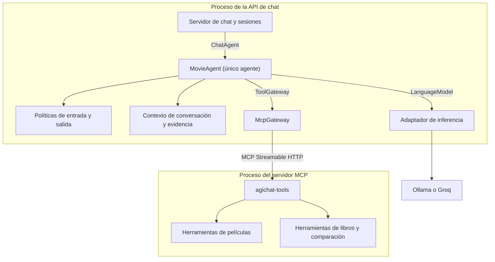
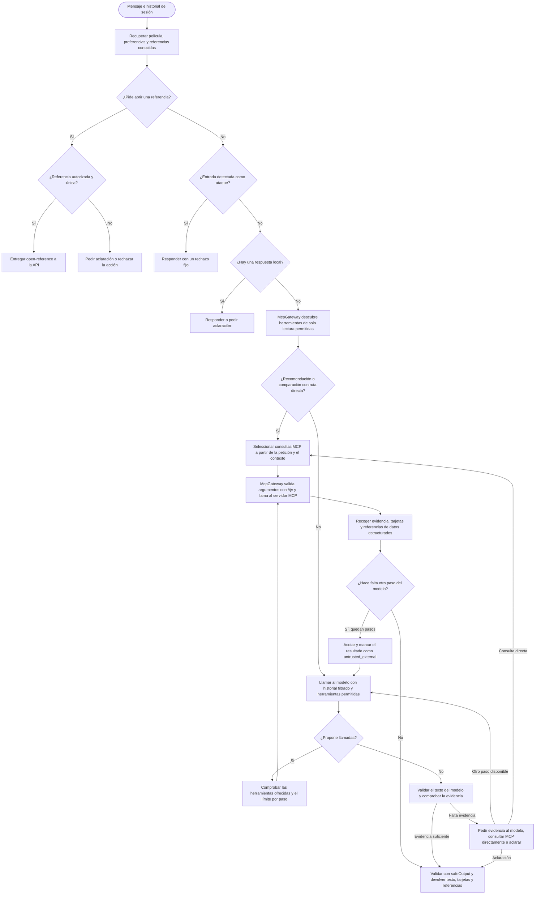
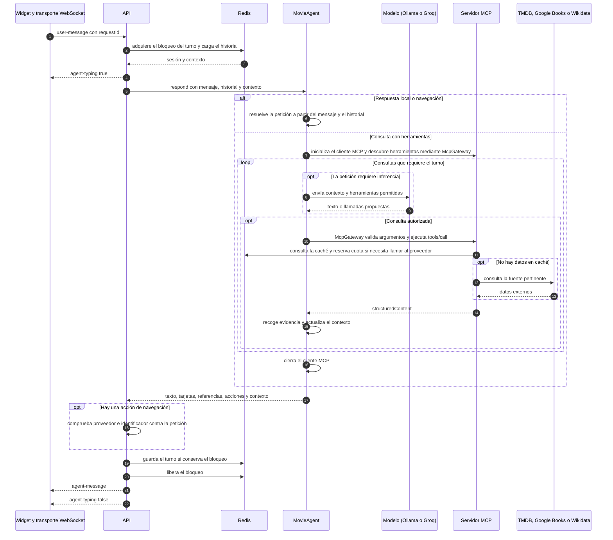
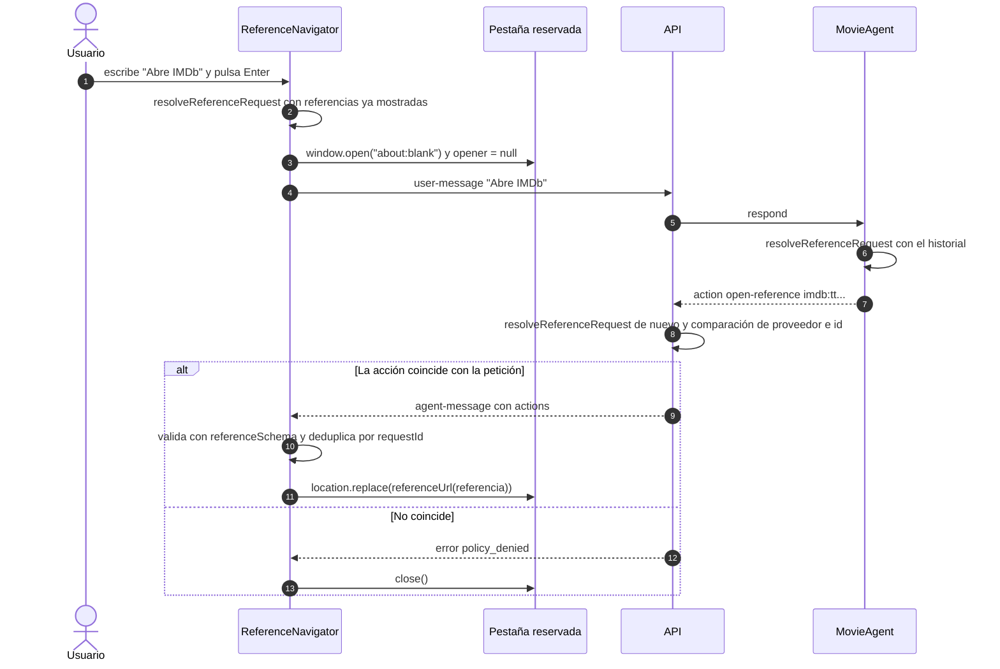
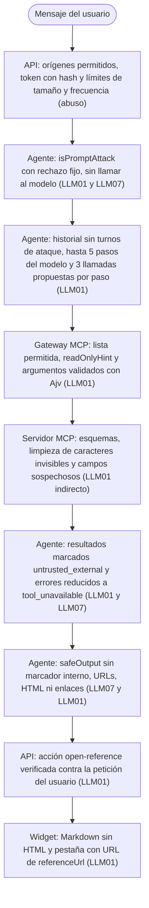

# Organización del agente (bajo nivel)

Este documento describe cómo funciona por dentro el agente de películas, cómo se
clasifica y qué controles de seguridad aplica. La implementación está en
`packages/agent/src/` y la integración con la red en `apps/api/src/server.ts`.

## Clasificación

AGIChat usa **un único agente con orquestación centralizada**. `MovieAgent`
controla el turno y decide cuándo resolverlo con reglas y herramientas o pedir
ayuda al modelo.

| Componente | Responsabilidad |
| --- | --- |
| `MovieAgent` | Recupera el contexto, aplica las políticas, coordina las consultas y arma la respuesta. |
| `LanguageModel` | Ollama o Groq. Propone llamadas a herramientas para los turnos que requieren inferencia. |
| `McpGateway` | Descubre herramientas de solo lectura de la lista permitida y valida sus argumentos. |
| Servidor MCP | Devuelve datos estructurados de seis herramientas de solo lectura con el catálogo de libros habilitado. |

La orquestación es centralizada porque `MovieAgent` conserva el control del turno
y aplica las mismas políticas a las rutas directas y a las asistidas por el
modelo. Las herramientas son funciones que ejecutan consultas concretas. Una
réplica de la API ejecuta su propia instancia de `MovieAgent` para las sesiones
que atiende. Los puertos `LanguageModel` y `ToolGateway` permiten probar el
flujo con dobles deterministas.

## Diagrama de organización del agente

`MovieAgent` concentra la coordinación. El adaptador de inferencia consulta al
modelo configurado. `McpGateway` valida las llamadas y el servidor MCP ejecuta
las herramientas de solo lectura. La vista muestra la configuración con el
catálogo de libros habilitado.

## Diagrama 1: ciclo interno de `MovieAgent.respond`

El flujo distingue las rutas directas y el bucle del modelo. La salida del
agente incluye texto y, cuando hay evidencia, tarjetas con póster y referencias.

- Las rutas directas cubren recomendaciones sencillas por género, seguimientos
  con criterios ya conocidos y comparaciones de una película identificada.
- `compare_movie_book` busca evidencia de la adaptación y devuelve un veredicto
  cuando puede vincular las obras. Si la coincidencia sigue siendo incierta, el
  agente solicita más información o indica que falta evidencia.
- En el bucle, `MovieAgent` admite hasta cinco pasos del modelo y hasta tres
  llamadas propuestas por paso. Las rutas directas tienen su propia lógica.
- `groundedText` arma el texto a partir de evidencia estructurada. `toolContext`
  compacta los datos que vuelven al modelo. La tabla de límites distingue ese
  contexto del historial que se usa para resolver referencias.
- Una herramienta rechazada o una salida inválida pueden terminar en
  `policy_denied`. Si se agotan los pasos, el agente usa un resumen válido
  disponible o devuelve el error correspondiente. La conexión MCP se cierra
  al terminar el turno, incluso si falla o se cancela.

## Diagrama 2: secuencia de un turno completo

El servidor libera el lease antes de enviar `agent-message`. En `ccd40d9` el
orden era el inverso, y un mensaje enviado de inmediato podía recibir `busy` (ver
[LIMITACIONES.md](../entrega/LIMITACIONES.md)).

## Diagrama 3: abrir una referencia sin clic

Los navegadores bloquean `window.open` si no ocurre durante un gesto del
usuario. Por eso el widget reserva la pestaña **al enviar el mensaje**, antes de
esperar al servidor (`packages/react/src/browser/ReferenceNavigator.ts` y
`packages/react/src/hooks/useChat.ts`).

Reglas que garantizan que solo se abre lo que el usuario pidió:

- La gramática compartida (`packages/protocol/src/referenceRequests.ts`) acepta
  órdenes directas como «Abre IMDb», «¿Puedes abrir Google Books?» o
  «Open IMDb», con un identificador opcional. Una orden incrustada en otra
  frase o una petición de ambas páginas a la vez no se acepta.
- La referencia debe haber aparecido antes en la conversación.
- La URL final la construye `referenceUrl` del protocolo, nunca el modelo:
  `https://www.imdb.com/title/<id>/` o `https://books.google.com/books?id=<id>`.
- Si hay un error, el turno termina sin acción o el widget se desmonta, la
  pestaña reservada se cierra.

## Diagrama 4: defensas en capas

El diagrama sigue un turno que entra en el bucle del modelo. Las rutas directas
con herramientas también pasan por la validación del gateway y de la salida.
Los controles se evalúan en [los casos OWASP LLM01 y LLM07](../evals/EVALS.md).

| Capa | Control | Archivo | Riesgo mitigado |
| --- | --- | --- | --- |
| Widget | Markdown sin HTML (`react-markdown` sin `dangerouslySetInnerHTML`) | `packages/react/src/components/MessageBubble/` | LLM01 (salida con HTML o scripts) |
| Widget | Solo navega con una acción validada; URL construida por `referenceUrl` | `ReferenceNavigator.ts` | LLM01 (navegación no autorizada) |
| API | Lista de orígenes, token con hash SHA-256 comparado en tiempo constante | `apps/api/src/server.ts` | Abuso de sesión |
| API | Límites de tamaño, frecuencia, conexiones y turnos | `apps/api/src/server.ts` | Abuso y denegación de servicio |
| API | `open-reference` debe coincidir con lo que pidió el usuario | `apps/api/src/server.ts` | LLM01 (acción inyectada) |
| Agente | `isPromptAttack` responde con un rechazo fijo sin llamar al modelo | `packages/agent/src/policy.ts` | LLM01 y LLM07 directos |
| Agente | Los turnos de ataque no vuelven al contexto | `MovieAgent.ts` | LLM01 en varios turnos |
| Agente | Resultados de herramientas como `untrusted_external` | `MovieAgent.ts` | LLM01 indirecto |
| Agente | `safeOutput` rechaza el marcador, URLs, `javascript:`, `data:`, HTML y enlaces Markdown | `policy.ts` | LLM07 y LLM01 |
| Agente | Hasta 5 pasos del modelo y 3 llamadas propuestas por paso | `MovieAgent.ts` | Consumo excesivo |
| Gateway MCP | Solo herramientas permitidas y con `readOnlyHint=true` | `McpGateway.ts` | LLM01 (herramientas no autorizadas) |
| Gateway MCP | Argumentos validados con Ajv | `McpGateway.ts` | LLM01 (argumentos manipulados) |
| Gateway MCP | Errores convertidos en `tool_unavailable` | `McpGateway.ts` | Filtración de detalles internos |
| Servidor MCP | Contenido externo sin caracteres invisibles y con campos sospechosos señalados | `packages/tmdb`, `packages/books` | LLM01 indirecto |

Los controles críticos están **en código**, no solo en el prompt. Aunque el
modelo obedeciera una instrucción inyectada, no podría usar una herramienta
fuera de la lista, abrir una URL arbitraria ni devolver el marcador interno.

## Catálogo de herramientas

Esquemas verificados en `apps/mcp-server/src/tools/` y `packages/books/src/schemas.ts`.
El contrato completo está en [SERVIDOR-MCP.md](../manuales/SERVIDOR-MCP.md).

| Herramienta | Propósito | Entradas principales | Solo lectura |
| --- | --- | --- | --- |
| `search_movies` | Buscar películas por título | `query`, `year`, `genres`, `page` | Sí |
| `get_movie_details` | Detalles, póster e identificador IMDb | `movie_id` | Sí |
| `recommend_movies` | Candidatos filtrados | `genres`, `year_from`, `year_to`, `min_rating`, `min_vote_count`, `original_language`, `sort_by` | Sí |
| `search_books` | Buscar libros candidatos | `query`, `start_index`, `max_results` | Sí |
| `get_book_details` | Metadatos y referencia de Google Books | `book_id` | Sí |
| `compare_movie_book` | Comparar película y libro con evidencia del servidor | `movie_id`, `book_id`, `preferences` | Sí |

## Límites

| Límite | Valor | Dónde |
| --- | --- | --- |
| Pasos del bucle del modelo | 5 | `MovieAgent` (`maxSteps`) |
| Llamadas propuestas por paso del modelo | 3 | `MovieAgent` y esquema de `OllamaModel` |
| Turnos de historial considerados para el modelo | Hasta 6, filtrados y recortados | `MovieAgent` |
| Turnos previos usados para recuperar referencias | Hasta 10, además del contexto vigente | `MovieAgent` |
| Elementos por resultado de herramienta | 5 | `MovieAgent` (`results` y `candidates`) |
| Tamaño máximo de un resultado | 32,000 caracteres | `MovieAgent` |
| Tamaño máximo de una respuesta | 6,000 caracteres | `safeOutput` |
| Tarjetas por respuesta | 5 | `MovieAgent` y protocolo |
| Referencias por respuesta | 20 | `MovieAgent` y protocolo |
| Parámetros con Ollama | `temperature 0`, `num_predict 384` (1024 en `ccd40d9`), `num_ctx 8192`, `think: false`, sin streaming | `OllamaModel.ts` |
| Parámetros con Groq | `temperature 0`, `max_completion_tokens 2048`, `parallel_tool_calls: false`, sin streaming | `GroqModel.ts` |
| Tiempo por llamada a una herramienta MCP | 18 s por defecto | `McpGateway` |
| Plazo compartido para conectar y listar herramientas MCP | 10 s por defecto | `McpGateway` |
| Tiempo por turno | `TURN_TIMEOUT_MS` (60 s por defecto; 180 s en la guía de arranque) | `apps/api/src/config.ts` |

## Códigos de error del protocolo

Definidos en `packages/protocol/src/protocol.ts`. Los mensajes provienen de
`apps/api/src/server.ts`.

| Código | Significado | Reintentable |
| --- | --- | --- |
| `invalid_frame` | El frame no cumple el protocolo | No |
| `unauthorized` | Sesión o token inválidos | No |
| `session_expired` | La sesión expiró | No |
| `busy` | Ya hay un turno en curso en la sesión o la réplica alcanzó `MAX_CONCURRENT_TURNS` | Sí |
| `duplicate_request` | Mismo `requestId` con otro contenido | No |
| `timeout` | Se superó `TURN_TIMEOUT_MS` | Sí |
| `cancelled` | El cliente canceló la petición | No |
| `unavailable` | Ollama, MCP o Redis no disponibles | Sí |
| `policy_denied` | Una política del agente o de la API bloqueó la operación | No |
| `limit_exceeded` | Se superó un límite de pasos, herramientas o tamaño | No |
| `rate_limited` | Un proveedor externo, como Groq, aplicó un límite de uso temporal; el mensaje indica cuál. Agregado en `main` | Sí |

El protocolo completo está en [PROTOCOLO.md](./PROTOCOLO.md).
