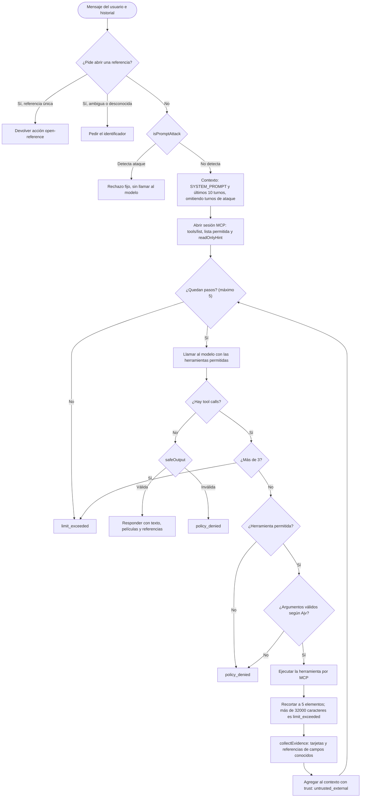
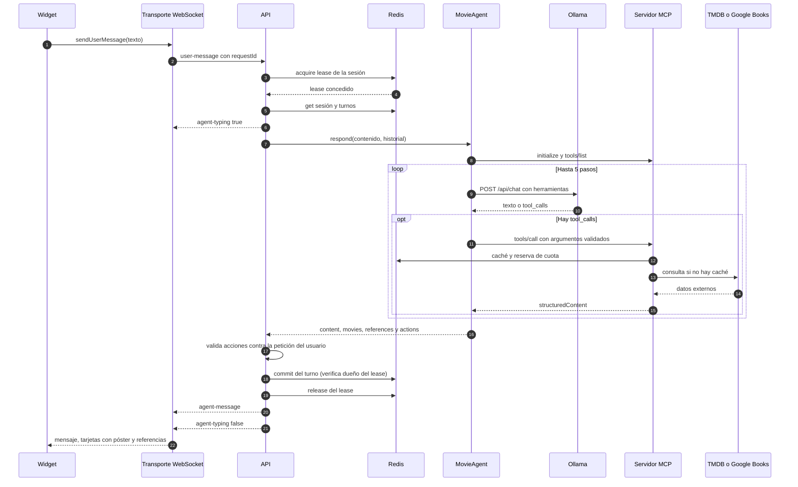
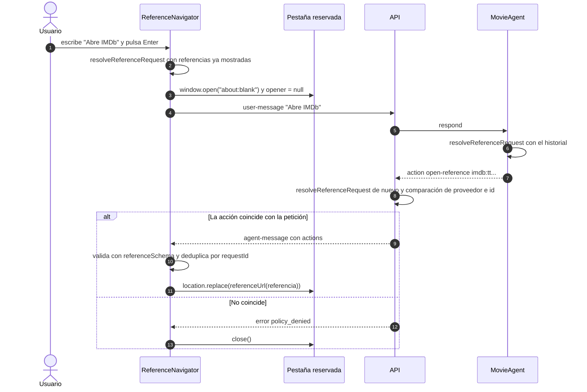
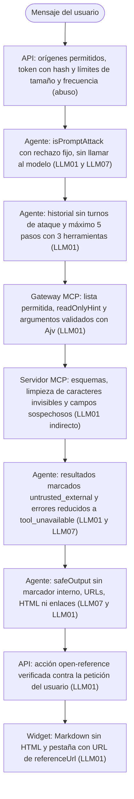

# Organización del agente (bajo nivel)

Este documento describe cómo funciona por dentro el agente de películas, cómo se
clasifica y qué controles de seguridad aplica. La implementación está en
`packages/agent/src/` y la integración con la red en `apps/api/src/server.ts`.

Revisado contra el código del commit `ccd40d9`. Después se integraron en `main`
el proveedor Groq, la reducción del contexto de herramientas (`toolContext.ts`) y
las comparaciones con Wikidata; las notas de este documento indican esos cambios.

## Clasificación

AGIChat usa **un único agente con orquestación centralizada**, que repite un
ciclo de llamada al modelo y ejecución de herramientas (*tool-calling loop*).
**No es un sistema multiagente.**

| Criterio | AGIChat |
| --- | --- |
| Número de agentes | Uno: `MovieAgent` |
| Quién decide | El modelo propone llamadas a herramientas; `MovieAgent` las autoriza, ejecuta y limita |
| Comunicación entre agentes | No existe |
| Herramientas | 6 herramientas de solo lectura en un servidor MCP |

**Por qué no es jerárquico.** No hay un agente orquestador que delegue en
subagentes. `MovieAgent` habla directamente con el modelo y con el gateway MCP.

**Por qué no es descentralizado.** No hay agentes pares que negocien entre sí.
Un único bucle controla todo el turno: contexto, límites, herramientas y la
salida final.

**Por qué 6 herramientas no son 6 agentes.** Una herramienta MCP es una función
determinista. Recibe argumentos validados y devuelve datos estructurados. No
razona, no conserva memoria y no decide qué hacer después. La única entidad que
decide es el modelo, dentro del ciclo de `MovieAgent`.

**Por qué basta para este alcance.** La tarea es una conversación por turnos con
pocas herramientas de lectura. Un único agente:

- mantiene un solo punto donde se aplican los controles de seguridad;
- reduce la latencia, porque Ollama es el recurso más lento y un MAS
  multiplicaría sus llamadas;
- facilita las pruebas deterministas, ya que el modelo y el gateway son puertos
  (`LanguageModel` y `ToolGateway`) que se sustituyen por dobles.

**Evolución posible (trabajo futuro, no implementado).** Un orquestador que
delegue en un subagente de películas y otro de libros convertiría el diseño en
**jerárquico**. Tendría sentido si cada dominio necesitara su propio
razonamiento de varios pasos o su propio modelo. Hoy no se justifica.

## Diagrama 1: ciclo interno de `MovieAgent.respond`

El diagrama sigue el orden de `packages/agent/src/MovieAgent.ts` en `ccd40d9`. En
`main` se mantuvo ese ciclo y se agregaron el estado de la conversación (película
seleccionada, criterios y candidatas), la verificación de respuestas
(`grounding.ts`) y la reducción del contexto de herramientas (`toolContext.ts`).
Esos agregados no están dibujados.

Detalles que el diagrama simplifica:

- El modelo es un puerto (`LanguageModel`). Además de Ollama local,
  `AGENT_MODE=groq` usa inferencia alojada en Groq y conserva las herramientas
  MCP. Ver [Inicio con Groq](../GROQ-INICIO.md).

- La validación con Ajv ocurre dentro de `McpGateway.call`. Si los argumentos
  no cumplen el JSON Schema descubierto, el gateway lanza `policy_denied`.
- Si la herramienta responde con error, el gateway entrega al modelo solo
  `{ "error": "tool_unavailable" }` y no reenvía detalles internos.
- La sesión MCP se cierra siempre al terminar el turno (`finally`).
- Si no se puede abrir la sesión MCP, el turno termina con `unavailable`.

## Diagrama 2: secuencia de un turno completo

El servidor libera el lease antes de enviar `agent-message`. En `ccd40d9` el
orden era el inverso, y un mensaje enviado de inmediato podía recibir `busy` (ver
[LIMITACIONES.md](../entrega/LIMITACIONES.md)).

## Diagrama 3: abrir una referencia sin clic

Los navegadores bloquean `window.open` si no ocurre durante un gesto del
usuario. Por eso el widget reserva la pestaña **al enviar el mensaje**, antes de
esperar al servidor (`packages/react/src/browser/ReferenceNavigator.ts` y
`packages/react/src/hooks/useChat.ts`).

Reglas que garantizan que solo se abre lo que el usuario pidió:

- La gramática compartida (`packages/protocol/src/referenceRequests.ts`) acepta
  órdenes directas como «Abre IMDb», «¿Puedes abrir Google Books?» o
  «Open IMDb», con un identificador opcional. Una orden incrustada en otra
  frase o una petición de ambas páginas a la vez no se acepta.
- La referencia debe haber aparecido antes en la conversación.
- La URL final la construye `referenceUrl` del protocolo, nunca el modelo:
  `https://www.imdb.com/title/<id>/` o `https://books.google.com/books?id=<id>`.
- Si hay un error, el turno termina sin acción o el widget se desmonta, la
  pestaña reservada se cierra.

## Diagrama 4: defensas en capas

El diagrama sigue el camino de un mensaje. Cada capa indica los controles que
aplica y el riesgo que mitiga.

| Capa | Control | Archivo | Riesgo mitigado |
| --- | --- | --- | --- |
| Widget | Markdown sin HTML (`react-markdown` sin `dangerouslySetInnerHTML`) | `packages/react/src/components/MessageBubble/` | LLM01 (salida con HTML o scripts) |
| Widget | Solo navega con una acción validada; URL construida por `referenceUrl` | `ReferenceNavigator.ts` | LLM01 (navegación no autorizada) |
| API | Lista de orígenes, token con hash SHA-256 comparado en tiempo constante | `apps/api/src/server.ts` | Abuso de sesión |
| API | Límites de tamaño, frecuencia, conexiones y turnos | `apps/api/src/server.ts` | Abuso y denegación de servicio |
| API | `open-reference` debe coincidir con lo que pidió el usuario | `apps/api/src/server.ts` | LLM01 (acción inyectada) |
| Agente | `isPromptAttack` responde con un rechazo fijo sin llamar al modelo | `packages/agent/src/policy.ts` | LLM01 y LLM07 directos |
| Agente | Los turnos de ataque no vuelven al contexto | `MovieAgent.ts` | LLM01 en varios turnos |
| Agente | Resultados de herramientas como `untrusted_external` | `MovieAgent.ts` | LLM01 indirecto |
| Agente | `safeOutput` rechaza el marcador, URLs, `javascript:`, `data:`, HTML y enlaces Markdown | `policy.ts` | LLM07 y LLM01 |
| Agente | Máximo 5 pasos y 3 herramientas por paso | `MovieAgent.ts` | Consumo excesivo |
| Gateway MCP | Solo herramientas permitidas y con `readOnlyHint=true` | `McpGateway.ts` | LLM01 (herramientas no autorizadas) |
| Gateway MCP | Argumentos validados con Ajv | `McpGateway.ts` | LLM01 (argumentos manipulados) |
| Gateway MCP | Errores convertidos en `tool_unavailable` | `McpGateway.ts` | Filtración de detalles internos |
| Servidor MCP | Contenido externo sin caracteres invisibles y con campos sospechosos señalados | `packages/tmdb`, `packages/books` | LLM01 indirecto |

Los controles críticos están **en código**, no solo en el prompt. Aunque el
modelo obedeciera una instrucción inyectada, no podría usar una herramienta
fuera de la lista, abrir una URL arbitraria ni devolver el marcador interno.

## Catálogo de herramientas

Esquemas verificados en `apps/mcp-server/src/tools/` y `packages/books/src/schemas.ts`.
El contrato completo está en [SERVIDOR-MCP.md](../manuales/SERVIDOR-MCP.md).

| Herramienta | Propósito | Entradas principales | Solo lectura |
| --- | --- | --- | --- |
| `search_movies` | Buscar películas por título | `query`, `year`, `genres`, `page` | Sí |
| `get_movie_details` | Detalles, póster e identificador IMDb | `movie_id` | Sí |
| `recommend_movies` | Candidatos filtrados | `genres`, `year_from`, `year_to`, `min_rating`, `min_vote_count`, `original_language`, `sort_by` | Sí |
| `search_books` | Buscar libros candidatos | `query`, `start_index`, `max_results` | Sí |
| `get_book_details` | Metadatos y referencia de Google Books | `book_id` | Sí |
| `compare_movie_book` | Comparar película y libro con evidencia del servidor | `movie_id`, `book_id`, `preferences` | Sí |

## Límites

| Límite | Valor | Dónde |
| --- | --- | --- |
| Pasos por turno | 5 | `MovieAgent` (`maxSteps`) |
| Herramientas por paso | 3 | `MovieAgent` y esquema de `OllamaModel` |
| Turnos de historial enviados al modelo | 10 | `MovieAgent` |
| Elementos por resultado de herramienta | 5 | `MovieAgent` (`results` y `candidates`) |
| Tamaño máximo de un resultado | 32,000 caracteres | `MovieAgent` |
| Tamaño máximo de una respuesta | 6,000 caracteres | `safeOutput` |
| Tarjetas por respuesta | 5 | `MovieAgent` y protocolo |
| Referencias por respuesta | 20 | `MovieAgent` y protocolo |
| Parámetros con Ollama | `temperature 0`, `num_predict 384` (1024 en `ccd40d9`), `num_ctx 8192`, `think: false`, sin streaming | `OllamaModel.ts` |
| Parámetros con Groq | `temperature 0`, `max_completion_tokens 2048`, `parallel_tool_calls: false`, sin streaming | `GroqModel.ts` |
| Tiempo por llamada MCP | 10 s | `McpGateway` |
| Tiempo por turno | `TURN_TIMEOUT_MS` (60 s por defecto; 180 s en la guía de arranque) | `apps/api/src/config.ts` |

## Códigos de error del protocolo

Definidos en `packages/protocol/src/protocol.ts`. Los mensajes provienen de
`apps/api/src/server.ts`.

| Código | Significado | Reintentable |
| --- | --- | --- |
| `invalid_frame` | El frame no cumple el protocolo | No |
| `unauthorized` | Sesión o token inválidos | No |
| `session_expired` | La sesión expiró | No |
| `busy` | Ya hay un turno en curso en la sesión o la réplica alcanzó `MAX_CONCURRENT_TURNS` | Sí |
| `duplicate_request` | Mismo `requestId` con otro contenido | No |
| `timeout` | Se superó `TURN_TIMEOUT_MS` | Sí |
| `cancelled` | El cliente canceló la petición | No |
| `unavailable` | Ollama, MCP o Redis no disponibles | Sí |
| `policy_denied` | Una política del agente o de la API bloqueó la operación | No |
| `limit_exceeded` | Se superó un límite de pasos, herramientas o tamaño | No |
| `rate_limited` | Un proveedor externo, como Groq, aplicó un límite de uso temporal; el mensaje indica cuál. Agregado en `main` | Sí |

El protocolo completo está en [PROTOCOLO.md](./PROTOCOLO.md).
