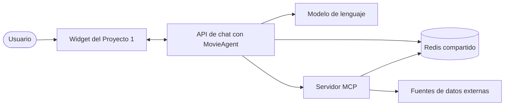
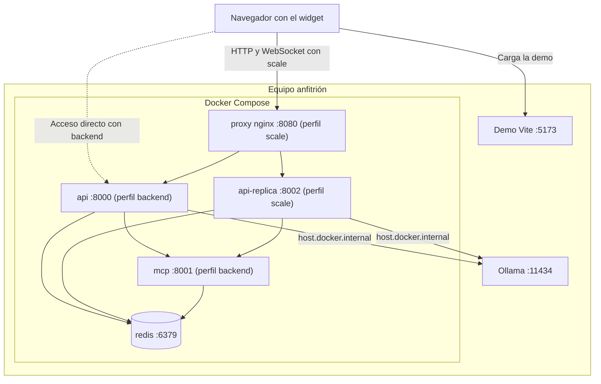

# Arquitectura de alto nivel

La vista de contexto muestra los componentes de AGIChat y cómo se comunican.
El flujo interno está en [Organización del agente](./AGENTE.md).

## Diagrama de contexto

El modelo de lenguaje puede ser Ollama o Groq. El servidor MCP consulta TMDB
para películas y usa Google Books y Wikidata cuando necesita datos de libros
y adaptaciones.

## Por qué escala

Con Redis, las réplicas de la API comparten las sesiones y el bloqueo temporal
de cada turno. Una conexión WebSocket permanece en la réplica que la aceptó y
una reconexión puede recuperar la sesión en otra. El servidor MCP atiende
solicitudes independientes y puede replicarse usando la misma caché y los
mismos contadores de cuota en Redis.

Las pruebas locales con dos réplicas de la API verificaron la continuidad de
sesión y la ejecución de un solo turno por sesión a la vez. La capacidad del
modelo y las cuotas de los proveedores siguen limitando el rendimiento.
[Mediciones y límites de escalabilidad](./ESCALABILIDAD.md).

## Diagrama de despliegue local

La vista técnica muestra la demo y Ollama en el equipo anfitrión, y los servicios
definidos en `compose.yaml` y `compose.backend.yaml`. El perfil `scale` agrega
el proxy nginx y la segunda réplica de la API. El navegador se conecta al proxy
con ese perfil o directamente a la API con el perfil `backend`. Los puertos de
Compose se publican en `127.0.0.1` y el chat local usa `ws://`.
[Manual de despliegue](../manuales/DESPLIEGUE.md).

| Servicio | Puerto local | Perfil | Origen |
| --- | --- | --- | --- |
| `redis` | 6379 | ninguno (siempre) | `compose.yaml` |
| `mcp` | 8001 | `backend` | `compose.backend.yaml` |
| `api` | 8000 | `backend` | `compose.backend.yaml` |
| `api-replica` | 8002 | `scale` | `compose.backend.yaml` |
| `proxy` | 8080 | `scale` | `compose.backend.yaml` + `infra/nginx.conf` |
| Ollama | 11434 | fuera de Compose | Aplicación del anfitrión |
| Demo | 5173 | fuera de Compose | `pnpm dev:demo` |

## Componentes

| Ruta | Responsabilidad | Tecnología | Guarda estado | Escala horizontalmente |
| --- | --- | --- | --- | --- |
| `packages/core` | Dominio del chat, `ChatEngine` y puerto `ITransportAdapter` | TypeScript sin dependencias de navegador | Solo en memoria del navegador | No aplica: corre en cada cliente |
| `packages/react` | Widget, `useChat`, Markdown seguro, tarjetas con póster, créditos TMDB y `ReferenceNavigator` | React | Estado de UI en el navegador | No aplica |
| `packages/embed` | Web Component `<agi-chat-widget>` y `mountChatWidget`; bundles ESM e IIFE | Custom Elements, Shadow DOM | No | No aplica |
| `packages/transport-mock` | Transporte simulado de la Fase 1 | TypeScript | No | No aplica |
| `packages/transport-websocket` | Sesión HTTP, WebSocket, reconexión acotada y cancelación | WebSocket del navegador | Credenciales en memoria | No aplica |
| `packages/protocol` | Protocolo v1, validadores y gramática de apertura de referencias | zod | No | Biblioteca compartida |
| `packages/agent` | `MovieAgent`, `OllamaModel`, `GroqModel`, `McpGateway`, políticas y evaluación | TypeScript, SDK MCP, Ajv | No | Se replica con la API |
| `packages/tmdb` | Cliente TMDB, normalización y validación | fetch, zod | No (usa la caché inyectada) | Biblioteca |
| `packages/books` | Cliente Google Books y comparación película–libro | fetch, zod | No (usa la caché inyectada) | Biblioteca |
| `packages/external-api` | Caché read-through, cuotas atómicas, reintentos y fetch resiliente | Memoria o Redis (Lua) | En Redis o en memoria | Sí, con Redis |
| `apps/api` | `POST /sessions`, `GET /healthz`, WebSocket `/chat` | Node `http`, `ws`, ioredis | Sesiones en Redis o memoria | Sí, con `SESSION_STORE=redis` |
| `apps/mcp-server` | Servidor MCP con 6 herramientas | SDK MCP, Streamable HTTP sin sesión | Caché y cuotas en Redis o memoria | Sí, con `SHARED_STORE=redis` |
| `apps/demo` | Demo de cine que consume el SDK | Vite | No | Sitio estático |
| Ollama | Inferencia del modelo `qwen3:4b-instruct-2507-q4_K_M` | Ollama local | Modelo en memoria | No en esta entrega |
| Groq (opcional) | Inferencia alojada, `openai/gpt-oss-120b` por defecto | API HTTPS de Groq, plan gratuito | No | Lo gestiona el proveedor, limitado por su cuota |
| Redis | Estado compartido | Redis 7.4 | Sí | Una instancia en local |

## Decisiones de arquitectura

| Decisión | Alternativas consideradas | Motivo | Consecuencia |
| --- | --- | --- | --- |
| Puertos y adaptadores, heredado de la Fase 1 | Acoplar la UI al backend | El widget se conecta a un mock o a un agente real con solo cambiar el adaptador de `ITransportAdapter` | La Fase 2 agregó `transport-websocket` sin cambiar `core` |
| WebSocket para el chat | HTTP con polling o SSE | Comunicación bidireccional: cancelación, indicador de escritura y respuestas correlacionadas por `requestId` | Cada conexión pertenece a una réplica mientras está abierta; el estado vive en Redis |
| MCP con Streamable HTTP sin sesión | Llamar a TMDB directamente desde el agente; stdio | Las herramientas quedan disponibles para cualquier cliente MCP y cada `POST /mcp` es independiente | Cualquier réplica del MCP atiende cualquier llamada sin afinidad |
| Un solo servidor MCP | Dos servidores, uno de películas y otro de libros (plan inicial) | Comparten transporte, logs, caché y política de cuotas; `compare_movie_book` necesita ambos catálogos | Separar dominios en varios servidores es posible a futuro sin cambiar el agente |
| Redis para estado compartido | Sesiones pegajosas; base de datos relacional | Operaciones atómicas en Lua para leases y cuotas; TTL nativo | Sin Redis no hay varias réplicas: con `memory` cada proceso tiene su propio estado |
| Ollama local detrás del puerto `LanguageModel` | Proveedor en la nube | Sin costo y sin registrar tarjeta | Ollama es el cuello de botella de cómputo; otro proveedor solo requiere otro adaptador de `LanguageModel` |
| Groq como segundo adaptador de `LanguageModel` | Solo Ollama | Inferencia más rápida sin depender del equipo local, sin tarjeta | Depende de la cuota gratuita (`rate_limited`) y envía las conversaciones a un servicio externo |
| Acciones de navegación ejecutadas por el cliente y validadas por el servidor | Que el LLM genere enlaces | El LLM no puede producir URLs (`safeOutput` las rechaza); la API comprueba que la acción coincida con la petición del usuario | La pestaña se abre sin clic en un enlace y solo hacia IMDb o Google Books |
