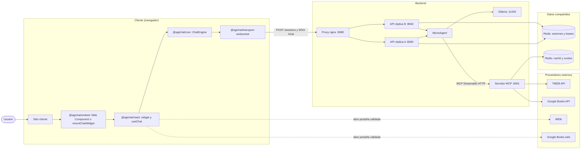
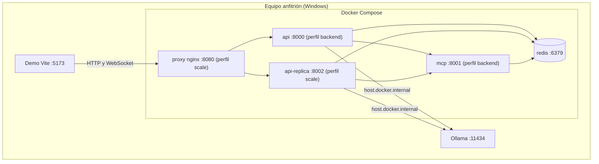

# Arquitectura de alto nivel

Este documento describe los componentes de AGIChat, cómo se comunican y por qué
la arquitectura puede escalar. Los detalles internos del agente están en
[AGENTE.md](./AGENTE.md) y las mediciones en [ESCALABILIDAD.md](./ESCALABILIDAD.md).

Revisado contra el código del commit `ccd40d9`.

## Diagrama de contexto

Notas sobre el diagrama:

- `MovieAgent` no es un servicio aparte. Es una clase de `packages/agent` que
  se ejecuta dentro de cada réplica de la API.
- El proxy y la segunda réplica solo existen con el perfil `scale` de Compose.
  En el arranque manual la API escucha directamente en el puerto 8000.
- En local la conexión es `ws://`, sin TLS. `wss://` es un requisito de un
  despliegue público, que no existe (ver [DESPLIEGUE.md](../manuales/DESPLIEGUE.md)).
- Las dos cajas de Redis son la misma instancia, con prefijos de clave distintos.

## Diagrama de despliegue local

Servicios definidos en `compose.yaml` y `compose.backend.yaml`. Ollama y la demo
se ejecutan en el equipo anfitrión. Todos los puertos se publican solo en
`127.0.0.1`.

| Servicio | Puerto local | Perfil | Origen |
| --- | --- | --- | --- |
| `redis` | 6379 | ninguno (siempre) | `compose.yaml` |
| `mcp` | 8001 | `backend` | `compose.backend.yaml` |
| `api` | 8000 | `backend` | `compose.backend.yaml` |
| `api-replica` | 8002 | `scale` | `compose.backend.yaml` |
| `proxy` | 8080 | `scale` | `compose.backend.yaml` + `infra/nginx.conf` |
| Ollama | 11434 | fuera de Compose | Aplicación del anfitrión |
| Demo | 5173 | fuera de Compose | `pnpm dev:demo` |

## Componentes

| Ruta | Responsabilidad | Tecnología | Guarda estado | Escala horizontalmente |
| --- | --- | --- | --- | --- |
| `packages/core` | Dominio del chat, `ChatEngine` y puerto `ITransportAdapter` | TypeScript sin dependencias de navegador | Solo en memoria del navegador | No aplica: corre en cada cliente |
| `packages/react` | Widget, `useChat`, Markdown seguro, tarjetas con póster, créditos TMDB y `ReferenceNavigator` | React | Estado de UI en el navegador | No aplica |
| `packages/embed` | Web Component `<agi-chat-widget>` y `mountChatWidget`; bundles ESM e IIFE | Custom Elements, Shadow DOM | No | No aplica |
| `packages/transport-mock` | Transporte simulado de la Fase 1 | TypeScript | No | No aplica |
| `packages/transport-websocket` | Sesión HTTP, WebSocket, reconexión acotada y cancelación | WebSocket del navegador | Credenciales en memoria | No aplica |
| `packages/protocol` | Protocolo v1, validadores y gramática de apertura de referencias | zod | No | Biblioteca compartida |
| `packages/agent` | `MovieAgent`, `OllamaModel`, `McpGateway`, políticas y evaluación | TypeScript, SDK MCP, Ajv | No | Se replica con la API |
| `packages/tmdb` | Cliente TMDB, normalización y validación | fetch, zod | No (usa la caché inyectada) | Biblioteca |
| `packages/books` | Cliente Google Books y comparación película–libro | fetch, zod | No (usa la caché inyectada) | Biblioteca |
| `packages/external-api` | Caché read-through, cuotas atómicas, reintentos y fetch resiliente | Memoria o Redis (Lua) | En Redis o en memoria | Sí, con Redis |
| `apps/api` | `POST /sessions`, `GET /healthz`, WebSocket `/chat` | Node `http`, `ws`, ioredis | Sesiones en Redis o memoria | Sí, con `SESSION_STORE=redis` |
| `apps/mcp-server` | Servidor MCP con 6 herramientas | SDK MCP, Streamable HTTP sin sesión | Caché y cuotas en Redis o memoria | Sí, con `SHARED_STORE=redis` |
| `apps/demo` | Demo de cine que consume el SDK | Vite | No | Sitio estático |
| Ollama | Inferencia del modelo `qwen3:4b-instruct-2507-q4_K_M` | Ollama local | Modelo en memoria | No en esta entrega |
| Redis | Estado compartido | Redis 7.4 | Sí | Una instancia en local |

## Decisiones de arquitectura

| Decisión | Alternativas consideradas | Motivo | Consecuencia |
| --- | --- | --- | --- |
| Puertos y adaptadores, heredado de la Fase 1 | Acoplar la UI al backend | El widget se conecta a un mock o a un agente real con solo cambiar el adaptador de `ITransportAdapter` | La Fase 2 agregó `transport-websocket` sin cambiar `core` |
| WebSocket para el chat | HTTP con polling o SSE | Comunicación bidireccional: cancelación, indicador de escritura y respuestas correlacionadas por `requestId` | Cada conexión pertenece a una réplica mientras está abierta; el estado vive en Redis |
| MCP con Streamable HTTP sin sesión | Llamar a TMDB directamente desde el agente; stdio | Las herramientas quedan disponibles para cualquier cliente MCP y cada `POST /mcp` es independiente | Cualquier réplica del MCP atiende cualquier llamada sin afinidad |
| Un solo servidor MCP | Dos servidores, uno de películas y otro de libros (plan inicial) | Comparten transporte, logs, caché y política de cuotas; `compare_movie_book` necesita ambos catálogos | Separar dominios en varios servidores es posible a futuro sin cambiar el agente |
| Redis para estado compartido | Sesiones pegajosas; base de datos relacional | Operaciones atómicas en Lua para leases y cuotas; TTL nativo | Sin Redis no hay varias réplicas: con `memory` cada proceso tiene su propio estado |
| Ollama local detrás del puerto `LanguageModel` | Proveedor en la nube | Sin costo y sin registrar tarjeta | Ollama es el cuello de botella de cómputo; otro proveedor solo requiere otro adaptador de `LanguageModel` |
| Acciones de navegación ejecutadas por el cliente y validadas por el servidor | Que el LLM genere enlaces | El LLM no puede producir URLs (`safeOutput` las rechaza); la API comprueba que la acción coincida con la petición del usuario | La pestaña se abre sin clic en un enlace y solo hacia IMDb o Google Books |

## Por qué escala

- **API sin estado local relevante.** Con `SESSION_STORE=redis`, las sesiones,
  el hash del token, los turnos y el lease viven en Redis. Una sesión creada en
  una réplica continúa en otra, y no se necesitan sesiones pegajosas.
- **MCP sin sesión.** Cada solicitud es independiente, y la caché y las cuotas
  se comparten en Redis con operaciones atómicas.
- **Límites por réplica.** `MAX_CONNECTIONS` y `MAX_CONCURRENT_TURNS` protegen
  cada proceso. Para agregar capacidad se agregan réplicas.
- **Lo que no escala** en esta entrega es Ollama (un proceso en un equipo) y las
  cuotas de los proveedores, que no aumentan con más réplicas.

El análisis completo y las mediciones están en [ESCALABILIDAD.md](./ESCALABILIDAD.md).
