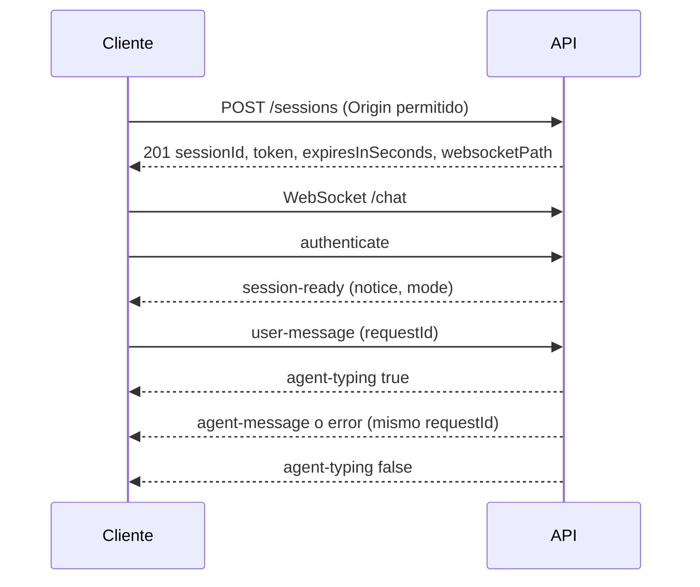

# Protocolo WebSocket v1

Contrato de red entre el widget y la API. Los esquemas y validadores están en
`packages/protocol/src/protocol.ts` y se exportan desde `@agichat/protocol`.
Cliente y servidor importan los mismos esquemas: no se duplican.

Revisado contra el código del commit `ccd40d9`.

## Flujo de conexión

1. El cliente crea una sesión con `POST /sessions`, sin cuerpo, desde un origen
   incluido en `CHAT_ALLOWED_ORIGINS`.
2. Guarda `sessionId` y `token` solo en la memoria del transporte.
3. Abre el WebSocket en `/chat` (`ws://` en local, `wss://` en un despliegue
   público).
4. Envía `authenticate` como primer frame. El token nunca va en la URL, en
   atributos del Web Component ni en logs. Si no se autentica en 5 s, el
   servidor cierra la conexión.
5. Espera `session-ready`, muestra el aviso de capacidades y respeta `mode`.
6. Envía mensajes con un `requestId` UUID y correlaciona las respuestas con ese
   mismo identificador.



## Respuesta de `POST /sessions`

```json
{
  "version": 1,
  "sessionId": "44e4c186-38a3-4fd1-9b91-64fa39ef1966",
  "token": "AAAAAAAAAAAAAAAAAAAAAAAAAAAAAAAAAAAAAAAAAAA",
  "expiresInSeconds": 1800,
  "websocketPath": "/chat"
}
```

El identificador y el token son ejemplos, no credenciales utilizables. El token
tiene 43 caracteres base64url. El servidor guarda solo su hash SHA-256.

## Frames del cliente

| Tipo | Campos | Descripción |
| --- | --- | --- |
| `authenticate` | `sessionId`, `token` | Primer frame obligatorio |
| `user-message` | `requestId`, `content` (1 a 4000 caracteres), `openReference` opcional | Mensaje del usuario |
| `cancel` | `requestId` | Cancela la petición en curso con ese identificador |

```json
{"version":1,"type":"user-message","requestId":"1cc321f1-406e-4bbf-bf62-37349f9988db","content":"Recomiéndame drama"}
```

## Frames del servidor

| Tipo | Campos relevantes | Uso del cliente |
| --- | --- | --- |
| `session-ready` | `sessionId`, `notice`, `mode` (`ollama`, `groq` o `fixture`) | Confirmar la autenticación y mostrar capacidades |
| `agent-typing` | `requestId`, `isTyping` | Indicador de escritura por petición |
| `agent-message` | `requestId`, `message`, `movies`, `references`, `actions` | Renderizar texto, tarjetas y acciones validadas |
| `error` | `requestId` opcional, `code`, `message`, `retryable` | Mostrar el error sin perder la correlación |

- `notice` es `CAPABILITY_NOTICE`: «Puedo recomendarte películas y, si lo
  deseas, compararlas con sus libros cuando exista información verificable.»
- `message` tiene `id`, `content` (hasta 8000 caracteres) y `timestamp` ISO.
- `movies` incluye hasta 5 tarjetas con `id`, `title`, `year`, `poster` e
  `imdbId`. `poster` solo se acepta si empieza por `https://image.tmdb.org/t/p/`.
- `references` incluye hasta 20 referencias:
  - `{ "provider": "imdb", "id": "tt" + 7 a 10 dígitos }`
  - `{ "provider": "google-books", "id": "[A-Za-z0-9_-]{1,128}" }`
- Cada referencia puede incluir `label` (nombre visible, hasta 350 caracteres) y
  `aliases` (hasta 5 nombres alternativos), que permiten pedir la apertura por
  nombre. Estos campos se agregaron en `main` después de `ccd40d9`.
- `actions` admite como máximo una acción `open-reference`.

El protocolo no implementa streaming de tokens. La respuesta llega completa.

Los códigos de `error` y si se pueden reintentar están en
[AGENTE.md](./AGENTE.md#códigos-de-error-del-protocolo).

## Límites

| Límite | Valor | Origen |
| --- | --- | --- |
| Longitud del mensaje | 4,000 caracteres | `MAX_MESSAGE_LENGTH` |
| Tamaño de frame | 32 KB | `maxPayload` del servidor WebSocket |
| Frames por minuto y conexión | 60 | `apps/api/src/server.ts` |
| Autenticación | 5 s | `apps/api/src/server.ts` |
| Conexiones por réplica | 64 (`MAX_CONNECTIONS`) | `apps/api/src/config.ts` |
| Turnos simultáneos por réplica | 4 (`MAX_CONCURRENT_TURNS`) | `apps/api/src/config.ts` |
| Turnos por conexión a la vez | 1 | `apps/api/src/server.ts` |
| Turnos conservados por sesión | 20 | `sessions.ts` y `RedisSessionStore.ts` |
| Duración de la sesión | 30 min de inactividad (`SESSION_TTL_MS`) | `apps/api/src/config.ts` |

No hay cola de espera. Si la sesión ya tiene un turno activo o la réplica
alcanzó su límite, el servidor responde `busy`.

## Cancelación y reconexión

- Para cancelar se envía `{"version":1,"type":"cancel","requestId":"..."}`
  con el UUID original. Al desconectar se cancela el trabajo de esa conexión.
- Para reconectar, el cliente conserva las credenciales, se autentica de nuevo
  y reenvía una petición incierta con el mismo `requestId` y contenido.
- Si el turno ya se confirmó, el servidor devuelve la respuesta guardada sin
  volver a llamar al agente, y con `actions` vacío para no abrir otra pestaña.
  Cambiar el contenido con el mismo `requestId` produce `duplicate_request`.
- Los turnos fallidos no se guardan. La sesión se renueva al confirmar un turno.

## Apertura de referencias

Después de que una referencia aparezca en la conversación, el usuario puede
escribir órdenes como estas:

| Mensaje | Resultado |
| --- | --- |
| `Abre IMDb` | Abre la única referencia de IMDb conocida |
| `¿Puedes abrir Google Books?` | Abre la única referencia de Google Books conocida |
| `Abre Google Books <id>` | Elige una referencia concreta cuando hay varias |
| `Abre IMDb y Google Books` | Pide aclaración: se solicitan por separado |

También se aceptan `Por favor, abre…`, `¿Podrías abrir…?`, `Open IMDb` y
`Can you open IMDb?`. Una negación o una orden incrustada en otra frase no
autoriza la apertura.

Opcionalmente, el frame puede indicar la referencia exacta:

```json
{
  "version": 1,
  "type": "user-message",
  "requestId": "1cc321f1-406e-4bbf-bf62-37349f9988db",
  "content": "Abre IMDb",
  "openReference": { "provider": "imdb", "id": "tt1160419" }
}
```

El widget del SDK no usa ese campo: el servidor resuelve la referencia a partir
del texto. La secuencia completa está en
[AGENTE.md](./AGENTE.md#diagrama-3-abrir-una-referencia-sin-clic).
